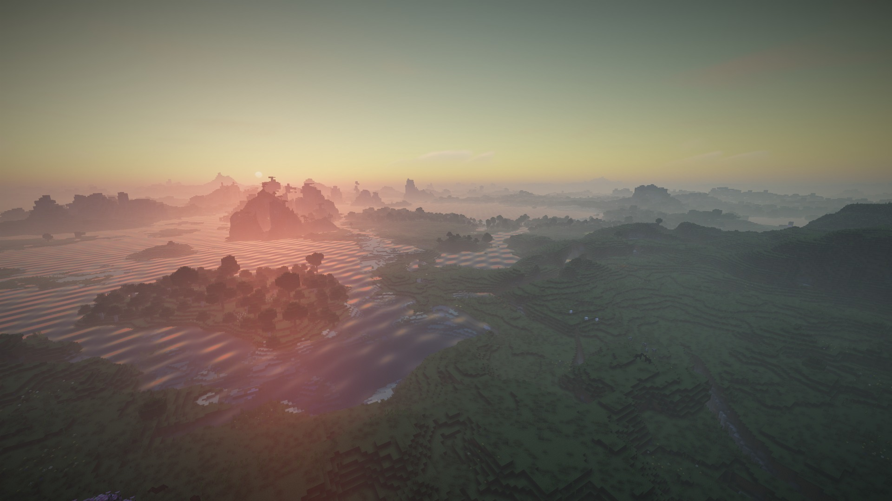
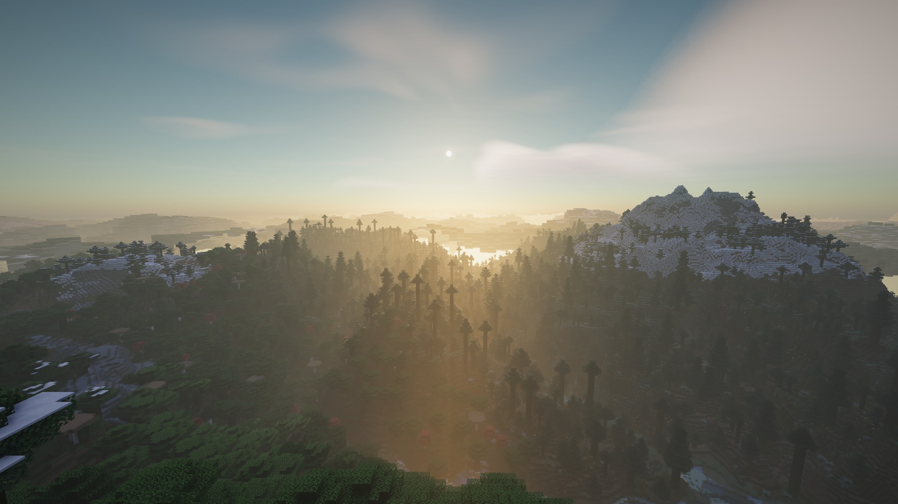
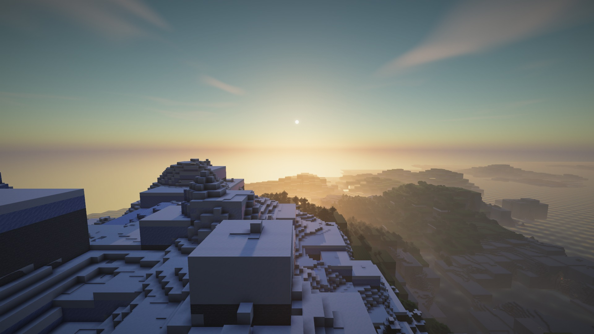
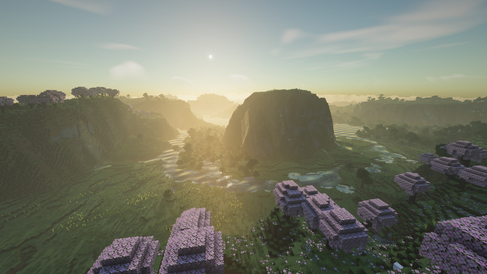
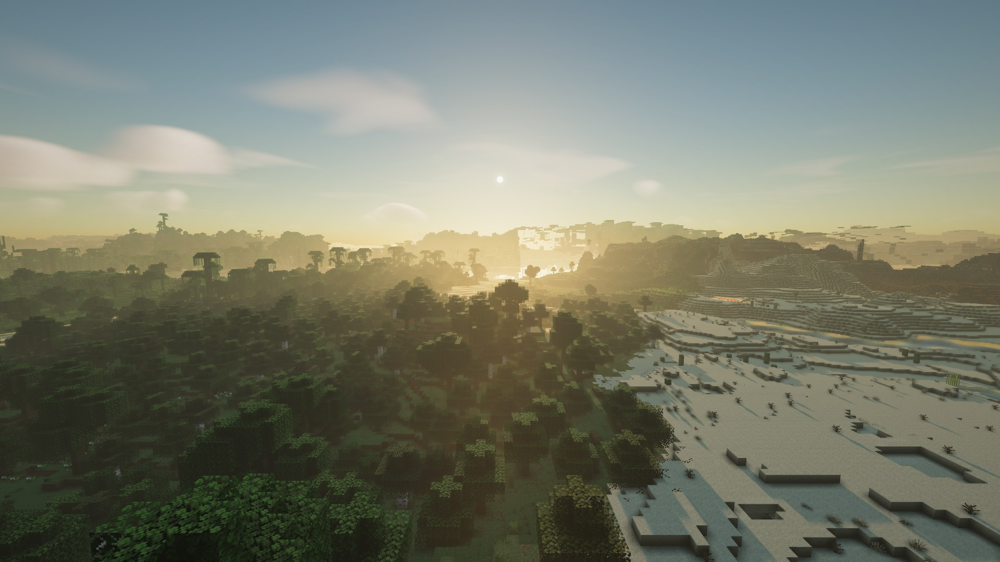
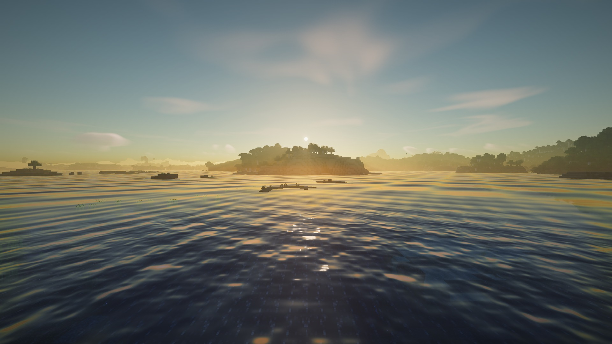
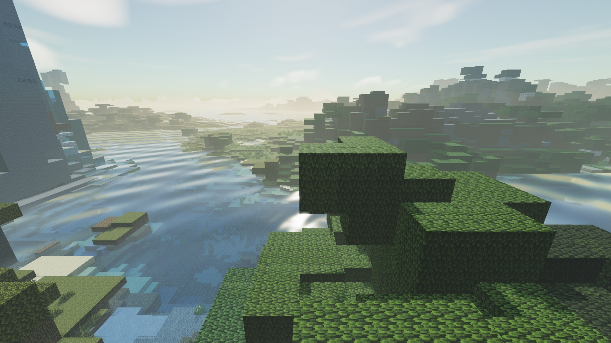
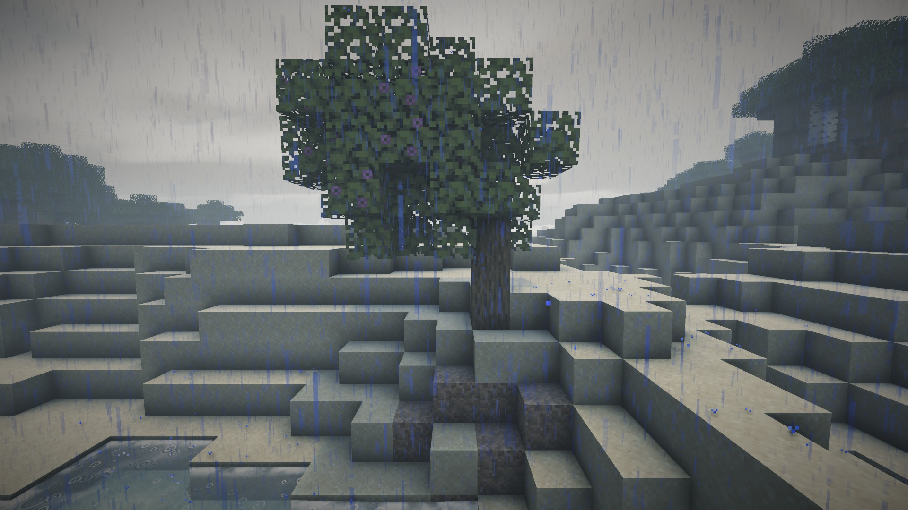
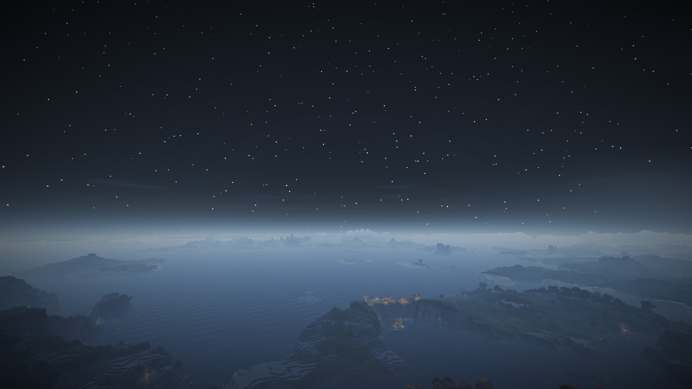
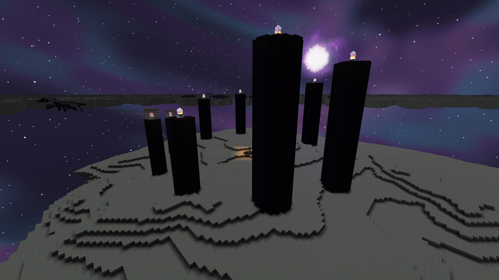

# Zenith

A clean-room MIT-licensed shader pack and optional hardware ray-tracing variant (`Zenith RT`) for [Horizon](https://github.com/horizon-rust/horizon) (**final Shader API `0.2`**, `schema = 1`, Horizon `nightly-2026-11-21` / `8f83e5c` or compatible newer builds).

## Screenshots

Zenith (not RT) on its highest settings: **Quality mode Ultra**, **Color Mood Cinematic**, 8192 shadows at 512 blocks with High filtering, temporal light, AO and reflections, morphological AA, 32 displacement cells; Horizon at 200% resolution scale, 32-chunk render distance and 256-chunk far terrain. Taken on 2026-11-24 with `nightly-2026-11-22-f1bb66f`, 1920×1080, HUD hidden, no post-editing.

| | |
|---|---|
|  |  |
| Misty sunrise over a river valley | Light shafts through a mountain forest at sunset |
|  |  |
| Dawn above a sea of clouds from the frozen peaks | Cherry grove at golden hour |
|  |  |
| Sunset over a jungle and a desert | Sunset over the open ocean |
|  |  |
| Morning over a mangrove swamp | Thunderstorm on the shore |
|  |  |
| Starry night above misty valleys | The End's cosmic sky and rift |

## Variants

- **`pack/zenith` — Zenith:** Rasterized PBR shader pack with PCSS shadows, translucent colored shadows and glass/ice refraction, dispersive optical water caustics, 4-swell water waves with planar/sky reflections, sky-view LUT atmosphere, volumetric rain/snowstorms, powder-snow immersion, pure 3D domain-warped volumetric dawn mist, multi-bounce GTAO, screen-space reflections, bloom pyramid, AgX-inspired HDR tone mapping, histogram auto-exposure, FXAA / morphological AA, cinematic optics, and cosmic End & volcanic Nether skies.
- **`variants/zenith-rt` — Zenith RT:** Standalone variant (`id = "zenith_rt"`) assembled from `pack/zenith` that adds hardware ray queries (`[ray_tracing]`):
  - **Reflections:** Traced mirror reflections on smooth terrain, metals, and water (including off-screen blocks and entities within the ray scene).
  - **Reflections + Shadows:** Near-field ray-traced sun/moon shadows plus persistent world-space stained-glass emitter lighting on both air shafts and solid receivers.
  - **Full RT:** Two-bounce diffuse global illumination evaluated at quarter resolution (`480×270`) and bilaterally upsampled with scene depth and normals.

## Quick Start (Zenith)

1. Copy the [`pack/zenith`](pack/zenith) directory to your Horizon shaderpacks folder:
   - **Windows:** `%APPDATA%\horizon\shaderpacks\zenith`
   - **Linux:** `~/.local/share/horizon/shaderpacks/zenith`
2. Ensure `horizon-shaders.toml` sits directly inside that `zenith/` directory.
3. Launch Horizon, open **Shader Packs**, and select **Zenith**.

## Building Zenith RT

`Zenith RT` is generated deterministically from `pack/zenith` and `variants/zenith-rt`:

```sh
node tools/build-zenith-rt.mjs outputs/zenith-rt/zenith_rt
```

Copy the generated `outputs/zenith-rt/zenith_rt` folder into your Horizon `shaderpacks/` directory as `zenith_rt/`, select **Zenith RT** in-game, and restart the client so Horizon enables hardware ray queries on supported GPUs. Choose the RT tier under **Effects → Ray Tracing** (`Reflections`, `Reflections + Shadows`, or `Full RT`).

## Validation

Using Horizon's shader compiler (`horizon-shader`):

```sh
horizon-shader check pack/zenith
node tools/build-zenith-rt.mjs outputs/zenith-rt/zenith_rt
horizon-shader check outputs/zenith-rt/zenith_rt
```

Note that Horizon requires a pack directory to contain **only** files declared in its `horizon-shaders.toml` (plus `README.md`, `LICENSE`, and optional `icon.png`). Keep temporary notes or unreferenced `.wgsl` files outside `pack/zenith/`.

## Repository Structure

```text
.
├── LICENSE                  # MIT License
├── PROVENANCE.md            # Algorithm attributions & clean-room design notes
├── pack/zenith/             # Zenith shader pack (WGSL stages and manifest)
├── variants/zenith-rt/      # Zenith RT hardware ray-query overlay sources & docs
└── tools/build-zenith-rt.mjs # Builds standalone zenith_rt from pack/zenith + overlay
```

## License

Released under the [MIT License](LICENSE). All rendering algorithms are implemented independently from published papers and Horizon's Shader API 0.2 specification; see [PROVENANCE.md](PROVENANCE.md) for citations.
